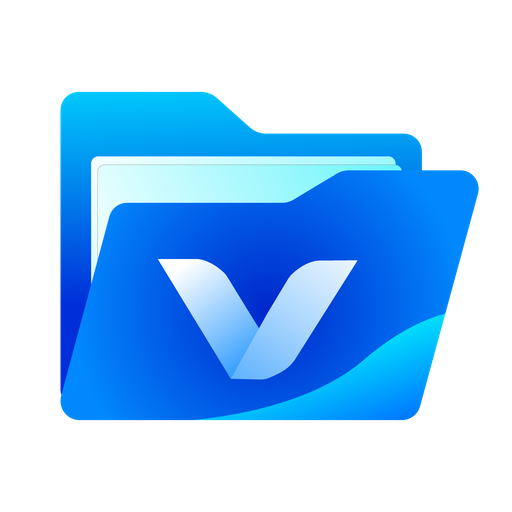
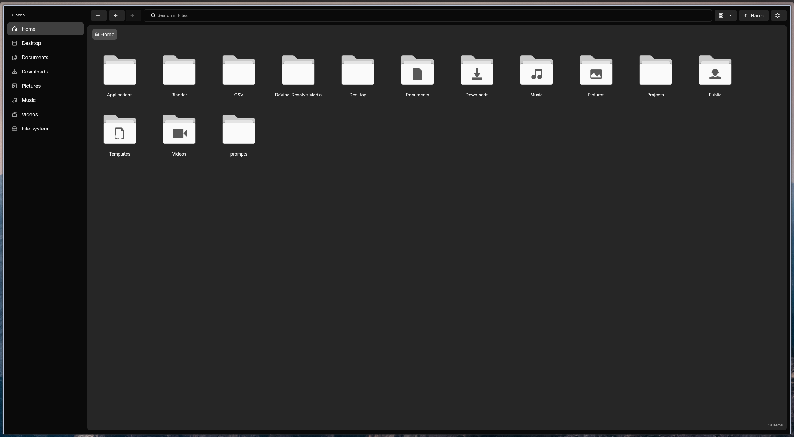

<div align="center">

<h1> Veyra</h1>

### A modern file manager for Linux

<a href="https://www.kernel.org/"></a> <a href="https://www.rust-lang.org/"></a> <a href="https://www.gpui.rs/"></a> <a href="#status"></a>

Built with [GPUI](https://www.gpui.rs/) and [gpui-kit](https://crates.io/crates/gpui-kit).

</div>

Veyra is a Linux desktop application. Its feature inventory and implementation
status are maintained in [FEATURE_README.md](FEATURE_README.md).

<p align="center">
  
</p>

## Contents

- [Feature inventory](FEATURE_README.md)
- [Requirements](#requirements)
- [Build and run](#build-and-run)
- [Data locations](#data-locations)
- [Status](#status)

## Requirements

- Linux (X11 or Wayland) with a Vulkan-capable GPU; GPUI renders through Vulkan
  on Linux (software Vulkan such as lavapipe also works)
- Rust 1.85 or newer (the crate uses edition 2024)
- The [Papirus icon theme](https://github.com/PapirusDevelopmentTeam/papirus-icon-theme)
  (`papirus-icon-theme` on most distributions) for file and folder icons
- GLib/GIO development libraries (`glib2` on Arch, `libglib2.0-dev` on Debian/Ubuntu)
  for installed application discovery and launching
- `gio` (GLib utilities) for desktop trash support
- FFmpeg, Poppler (`poppler` on Arch, `poppler-utils` on Debian/Ubuntu), and
  librsvg (`librsvg` on Arch, `librsvg2-bin` on Debian/Ubuntu) for video, PDF,
  and SVG thumbnails
- LibreOffice (`libreoffice` or `soffice`) for Office document thumbnails and
  formatted Word/Office previews; DOCX text previews also work without it
- Optional: registered freedesktop thumbnailers for additional document and
  media formats

## Build and run

```sh
git clone https://github.com/arrifat346afs/Veyra.git
cd Veyra
cargo run --release
```

The binary is written to `target/release/veyra`.

### Build with GitHub Actions

Open **Actions → Build Linux → Run workflow** and select the branch to build.
The workflow runs for pull requests, version tags beginning with `v`, and
manual runs. Pushes to `main` do not start a build. The manual run button
becomes available once the workflow is on the repository's default branch.

When the run succeeds, download **veyra-linux-x86_64** from its **Artifacts**
section. The artifact contains a `.tar.gz` archive and an AppImage. Make the
AppImage executable and run it directly:

```sh
chmod +x Veyra-*-x86_64.AppImage
./Veyra-*-x86_64.AppImage
```

Or unzip the artifact and extract the `.tar.gz` archive to run the standalone
binary:

```sh
sha256sum -c veyra-linux-x86_64.tar.gz.sha256
tar -xzf veyra-linux-x86_64.tar.gz
cd veyra-linux-x86_64
./veyra
```

The `.tar.gz` file is a compressed application archive, not an Arch package;
`pacman -U` cannot install it. Extract it with `tar -xzf`, then run `./veyra`
or use `./scripts/install-desktop.sh` to add it to your user app menu. To
install through pacman, download the `.pkg.tar.zst` file from the release and
run `sudo pacman -U ./veyra-*.pkg.tar.zst`.

The archive includes the release binary and the portal integration scripts.
It targets x86_64 Linux and is built on Ubuntu 24.04; it requires compatible
system libraries and the runtime requirements above. It does not bundle those
libraries. Workflow artifacts are retained for 30 days.

To add Veyra to your desktop app menu with its icon, extract the archive and run
`./scripts/install-desktop.sh`. This installs the binary to `~/.local/bin` and
the launcher and icon to your user data directory. You can also run `./veyra`
directly from the extracted folder.

### Publish a GitHub Release

Pull requests build the app and upload a workflow artifact. Pushes to `main`
do not trigger builds. To publish a GitHub Release, manually run **Build Linux**
from the Actions page.
That manual run publishes a `v`-prefixed package version (for example,
`v0.1.1`), the application archive, an AppImage, and an Arch package
(`.pkg.tar.zst`), with SHA-256 checksums. The workflow reads the version from
`Cargo.toml`; update that version when you want to publish a new release.
Manual builds for the same version update that release's assets.

For a named version release, push a version tag instead:

```sh
git tag v0.1.1
git push origin v0.1.1
```

The workflow uses the version tag as the release tag when building a tag.
Releases include generated release notes, `veyra-linux-x86_64.tar.gz`, an
AppImage, the Arch package, and their SHA-256 checksums. Download the AppImage
from the repository's **Releases** page, mark it executable, and run it. The
other assets are also available there. Release assets do not have the workflow
artifacts' 30-day expiry.

You can also run **Build Linux** manually against an existing `v*` tag to
publish it. Rerunning a workflow run replaces the matching assets on its
existing release.

## Data locations

Veyra follows the XDG base directory specification:

| What | Path |
| --- | --- |
| Settings | `$XDG_CONFIG_HOME/veyra/settings.json` (default `~/.config/...`) |
| Bookmarks | `$XDG_DATA_HOME/filemanager/bookmarks` (default `~/.local/share/...`) |
| Thumbnail cache | `$XDG_CACHE_HOME/veyra/thumbnails/v1` (default `~/.cache/...`) |

On first run the bookmark file is seeded once from GTK's bookmark list, if present.
After that Veyra owns the list and never reads GTK's file again.

## Project layout

```
src/
  app.rs            application setup and theme registration
  windows/          main window state, navigation, and rendering
  layouts/          topbar, sidebar, and content pane
  settings/         preferences, settings panel, and reusable controls
  selection/        click, multi-select, and rubber-band selection
  context_menu/     menu layout, commands, dialogs, clipboard, and file operations
  thumbnails/       thumbnail cache and freedesktop thumbnailer discovery
  services/         persistent bookmarks
  keyboard_shortcuts/
```

## Status

Early development. See [FEATURE_README.md](FEATURE_README.md) for the current
feature inventory and implementation status.
